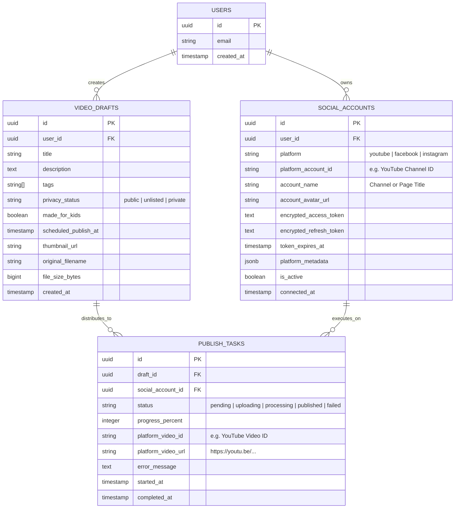

# Social-Hub: Multi-Account Video Distribution Platform

## 1. Vision & Overview
**Social-Hub** is a creator-first distribution platform enabling creators, media teams, and agencies to connect multiple social media accounts (multiple YouTube channels, and in future versions, Facebook pages/groups and Instagram profiles) and distribute video content across selected channels simultaneously from a single unified workspace.

For **Version 1 (V1)**, the platform focuses on:
1. **User Authentication & Workspace Management**: Secure user accounts powered by Supabase Auth.
2. **Multi-Channel YouTube Connectivity**: Connect and manage multiple distinct YouTube channels (even across different Google accounts or brand channels) with OAuth 2.0 and token auto-refresh.
3. **High-Performance Video Uploader**: Browser-to-YouTube Resumable Upload pipeline (direct streaming from client to Google API via signed session URLs, eliminating server bandwidth bottlenecks and supporting up to 1GB videos in MP4, MOV, and WebM formats).
4. **Comprehensive Video Metadata & Scheduling**: Full control over Title, Description, Tags, Privacy status (Public, Unlisted, Private), COPPA ("Made for Kids") compliance, Custom Thumbnail uploads, and Scheduled Release (`publishAt` timestamp).
5. **Multi-Channel Publishing Orchestrator**: Publish or schedule videos to multiple selected YouTube channels with real-time per-channel progress and direct YouTube video link generation.
6. **Apple Design System UI**: Built strictly adhering to Apple's Human Interface Guidelines and `DESIGN.md` (SF Pro typography, Action Blue `#0066cc` accents, capsule/pill CTAs, alternating parchment and white surfaces, zero gratuitous shadows/gradients).

---

## 2. Tech Stack
- **Framework**: Next.js 15 (App Router with React 19, Server Actions & API Route Handlers)
- **Backend & Database**: Supabase (PostgreSQL with Row Level Security, Supabase Auth, Secure Vault/Encrypted storage for OAuth tokens)
- **Video Upload Engine**: YouTube Data API v3 Resumable Upload protocol (client-side chunked streaming via authenticated upload URLs)
- **Styling & UI**: Tailwind CSS configured with Apple Design System tokens from `DESIGN.md`, Lucide React icons, and SF Pro typography hierarchy.
- **Languages**: TypeScript (Strict mode end-to-end)

---

## 3. Architecture & Data Model (Multi-Platform Extensible)

The data model is engineered from Day 1 to be polymorphic, supporting YouTube in V1 and effortlessly scaling to Facebook and Instagram in V2:

---

## 4. Key Architectural Decisions (Aligned with User Inputs)

| Decision | Chosen Approach | Rationale |
|---|---|---|
| **Fullstack Architecture** | Next.js App Router + Supabase | Single unified codebase for secure server-side OAuth callback handling, token refreshing, and responsive UI. |
| **Video Upload Strategy** | Direct Browser-to-YouTube Resumable Upload | Client asks Next.js server route to initiate a resumable upload session with YouTube Data API using the channel's access token, receives an authenticated session URI, and streams video chunks directly from the browser to Google servers. Eliminates server memory/bandwidth limits and supports videos up to 1GB seamlessly. |
| **Publishing Scope** | Instant Publish + Scheduled Release | Implements YouTube's `status.publishAt` ISO timestamp when video privacy is set to `private`, allowing creators to schedule video drops in advance. |
| **Design Language** | Apple Design System (`DESIGN.md`) | Minimalist, museum-quality whitespace, `#0066cc` Action Blue, SF Pro font stack, full-pill CTAs, and active scale feedback (`scale(0.95)`). |
| **Multi-Channel Isolation** | Row Level Security (RLS) + Encrypted Tokens | Each user can only view and dispatch to their own connected channels and drafts. Refresh tokens are secured server-side. |

---

## 5. User Workflow (V1)

1. **Sign Up / Login**: User creates an account with email/password via Supabase Auth.
2. **Channel Management**:
   - User navigates to **"Connected Channels"**.
   - Clicks **"Connect YouTube Channel"** (initiates Google OAuth flow requesting `youtube.upload` and `youtube.readonly` scopes).
   - Authorizes Google account / selects channel.
   - Channel appears in list with Avatar, Name, Subscriber count, and status badge.
   - User can repeat the flow to add 2nd, 3rd, or Nth YouTube channels.
3. **Video Creation & Multi-Upload**:
   - User navigates to **"Distribute Video"**.
   - Selects one or multiple connected YouTube channels via toggles.
   - Selects video file (drag-and-drop MP4/MOV/WebM up to 1GB) and optional custom thumbnail image.
   - Fills in Title, Description, Tags, Privacy (Public, Unlisted, Private), COPPA flag, and optional Scheduled Date/Time.
   - Clicks **"Distribute to Selected Channels"**.
4. **Live Progress & Links**:
   - Real-time progress bar per channel.
   - On completion, shows clickable YouTube links (`https://youtu.be/<id>`) and saves to publishing history.
