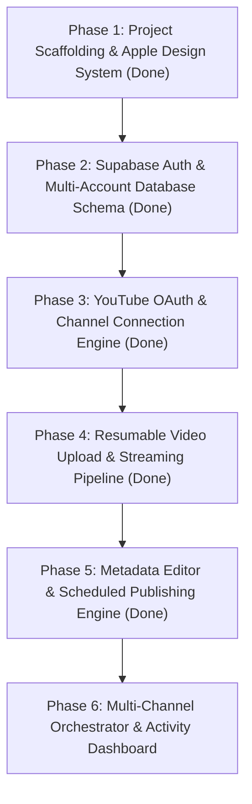

# Social-Hub: Roadmap (V1 Milestone)

## Milestone 1: Multi-Channel YouTube Video Distribution Platform

---

### [x] Phase 1: Project Scaffolding & Apple Design System Setup
- [x] Initialize Next.js 15 (App Router, TypeScript, React 19, Tailwind CSS v3).
- [x] Configure Apple Design tokens from `DESIGN.md` in Tailwind theme.
- [x] Scaffold base layout with global navigation, sidebar, and breadcrumbs.
- [x] Set up environment variable schemas (`.env.example` and validation).
- [x] Verified zero-error Next.js production build with all routes prerendered.

### [x] Phase 2: Supabase Auth & Multi-Account Database Schema
- [x] Initialize Supabase client for Next.js 15 (SSR / async cookie-based session handling).
- [x] Create and execute PostgreSQL migrations in live Supabase database (`cpoufdzgjpqvxuanbpxj`):
  - [x] `profiles`, `social_accounts`, `video_drafts`, `publish_tasks` tables.
  - [x] Row Level Security (RLS) active and confirmed on all 4 tables (`rowsecurity: true`).
- [x] AES-256-GCM token encryption & decryption utility.
- [x] Apple-styled Auth UI (`/login`).
- [x] Next.js session middleware protecting dashboard routes.

### [x] Phase 3: YouTube OAuth & Channel Connection Engine
- [x] Google OAuth 2.0 flow with CSRF protection and multi-channel selection (`prompt=consent select_account`).
- [x] Channel profile discovery (`youtube.channels.list`) and token encryption at rest.
- [x] Automated token refresh rotation engine (`src/lib/youtube/token-manager.ts`).
- [x] Channel server actions and Apple-styled channel cards on `/channels`.
- [x] Real-time channel metrics in overview dashboard.

### [x] Phase 4: Resumable Video Upload & Streaming Pipeline
- [x] Server-side resumable upload session initializer (`/api/youtube/upload/initiate`).
- [x] Client-side direct-to-Google streaming engine (`ResumableUploader` class).
- [x] Apple-styled media uploader UI:
  - [x] `VideoDropzone` component with preview player and memory lifecycle cleanup.
  - [x] `ThumbnailPicker` component for 16:9 images.

### [x] Phase 5: Metadata Editor & Scheduled Publishing Engine
- [x] YouTube Category dictionary (`src/lib/youtube/categories.ts`) covering 14 standard categories.
- [x] Custom thumbnail attachment route (`/api/youtube/thumbnail/set`) calling YouTube `thumbnails.set`, with graceful handling for unverified channels.
- [x] Rich tag chip editor (`TagInput` component) enforcing 500-char combined limit.
- [x] Scheduled date & time picker (`SchedulePicker` component) with local timezone formatting and ISO 8601 conversion.
- [x] Video draft persistence server actions (`saveVideoDraft`, `getVideoDrafts`, `deleteVideoDraft`).
- [x] Integrated `UploadWizard` with categories, tags, scheduling, and draft saving.

### Phase 6: Multi-Channel Orchestrator & Activity Dashboard
- Implement Multi-Channel selector allowing creators to check which connected channels receive the video.
- Multi-channel dispatch engine: initiates parallel or sequenced resumable upload sessions across all chosen channels.
- Real-time progress dashboard per channel (Percentage bar, Uploading, Processing, Published with watch link, or Failed with retry).
- Publishing History view displaying all past distribution jobs with filter by channel and status.
- Final end-to-end integration test and verification against user specifications.
