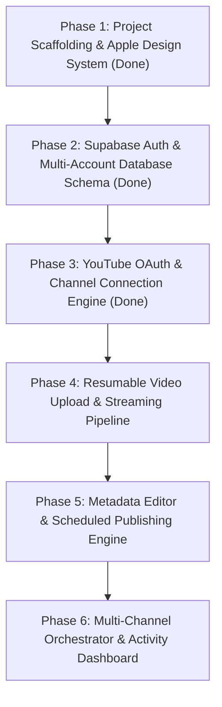

# Social-Hub: Roadmap (V1 Milestone)

## Milestone 1: Multi-Channel YouTube Video Distribution Platform

---

### [x] Phase 1: Project Scaffolding & Apple Design System Setup
- [x] Initialize Next.js 15 (App Router, TypeScript, React 19, Tailwind CSS v3).
- [x] Configure Apple Design tokens from `DESIGN.md` in Tailwind theme.
- [x] Scaffold base layout with global navigation, sidebar, and breadcrumbs.
- [x] Set up environment variable schemas (`.env.example` and validation).
- [x] Verified zero-error Next.js production build with all routes prerendered.

### [x] Phase 2: Supabase Auth & Multi-Account Database Schema
- [x] Initialize Supabase client for Next.js 15 (SSR / async cookie-based session handling).
- [x] Create and execute PostgreSQL migrations in live Supabase database (`cpoufdzgjpqvxuanbpxj`):
  - [x] `profiles` table with automated trigger.
  - [x] `social_accounts` table (polymorphic design for `youtube`, `facebook`, `instagram`).
  - [x] `video_drafts` table.
  - [x] `publish_tasks` table.
  - [x] Row Level Security (RLS) active and confirmed on all 4 tables (`rowsecurity: true`).
- [x] AES-256-GCM token encryption & decryption utility.
- [x] Apple-styled Auth UI (`/login`).
- [x] Next.js session middleware protecting dashboard routes.

### [x] Phase 3: YouTube OAuth & Channel Connection Engine
- [x] Google OAuth 2.0 flow:
  - [x] Route handler `/api/auth/youtube/connect` generating authorization URL with CSRF state cookie, `access_type=offline`, and `prompt=consent select_account` to easily link multiple channels.
  - [x] Route handler `/api/auth/youtube/callback` exchanging code for access and refresh tokens.
  - [x] Fetch channel profile via `youtube.channels.list(mine=true, part=snippet,statistics)`.
  - [x] Encrypt tokens at rest and store channel metadata in `social_accounts`.
- [x] Token refresh manager (`src/lib/youtube/token-manager.ts`) automatically detecting expired tokens and rotating with Google.
- [x] Channel management server actions (`getConnectedChannels`, `disconnectChannel`, `toggleChannelActive`).
- [x] Apple-styled "Connected Channels" page (`/channels`):
  - [x] Multi-channel grid with avatars, handles, subscriber count badges, status toggles, and disconnect actions.
  - [x] Setup banner warning if Google Cloud OAuth credentials need configuration.
  - [x] Real-time channel metrics dynamically updated in `/dashboard`.

### Phase 4: Resumable Video Upload & Streaming Pipeline
- Build client-side drag-and-drop file uploader component with preview:
  - Video format validation (MP4, MOV, WebM up to 1GB).
  - Thumbnail picker with aspect ratio preview.
- Implement YouTube Resumable Upload protocol:
  - API endpoint `/api/youtube/upload/initiate`: calls YouTube Data API `videos.insert(uploadType=resumable)` on behalf of the selected channel.
  - Returns direct Google upload session URI to browser.
  - Client-side chunked uploader: streams video directly to Google server with byte-level progress reporting and resume capability.

### Phase 5: Metadata Editor & Scheduled Publishing Engine
- Build comprehensive video details editor:
  - Title input with character counter (max 100).
  - Description textarea with character counter (max 5000).
  - Tags input with badge/chip UI (max 500 chars).
  - Category selector (Entertainment, Education, Gaming, Tech, etc.).
  - Privacy status dropdown (Public, Unlisted, Private).
  - COPPA compliance checkbox ("Yes, it's made for kids" / "No, not made for kids").
  - Scheduled Release picker (Date + Time input, converts to ISO 8601 `publishAt` for YouTube when privacy is `private`).
  - Custom thumbnail upload and association (`thumbnails.set` API).

### Phase 6: Multi-Channel Orchestrator & Activity Dashboard
- Implement Multi-Channel selector allowing creators to check which connected channels receive the video.
- Multi-channel dispatch engine: initiates parallel or sequenced resumable upload sessions across all chosen channels.
- Real-time progress dashboard per channel (Percentage bar, Uploading, Processing, Published with watch link, or Failed with retry).
- Publishing History view displaying all past distribution jobs with filter by channel and status.
- Final end-to-end integration test and verification against user specifications.
